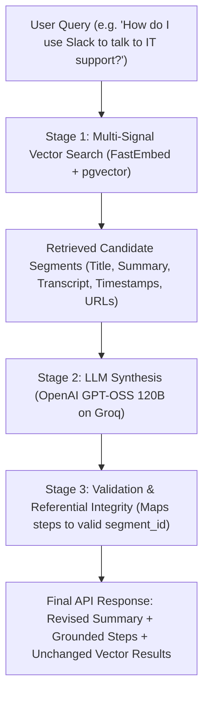

# AI Overview & Grounded Step-by-Step Search Documentation

This document describes the architectural design, model selection, prompt engineering, hyperparameters, and configuration instructions for the **AI Overview Search** feature in Khemra.

---

## 1. Architecture & Pipeline Overview

The AI Overview endpoint (`POST /api/rag/knowledge/search/ai-overview/`) operates in two sequential stages:



1. **Stage 1 — Retrieval:** Runs standard 4-facet vector similarity search (`topic`, `summary`, `question`, `keyword`) against indexed segments.
2. **Stage 2 — Synthesis:** Feeds candidate segments into the LLM with strict grounding constraints to revise the text into an overall natural summary and numbered procedural steps.
3. **Stage 3 — Integrity Verification:** Verifies that every step's `segment_id` accurately matches a retrieved segment from vector search (falling back to the top result if an ID is hallucinated).
4. **Fallback Mechanism:** If Groq times out (>4.0s) or fails, the endpoint automatically returns all vector segments normally with `summary: null` and `steps: []` without throwing a `500 Server Error`.

---

## 2. Active Model Details

| Attribute | Configuration |
| :--- | :--- |
| **Active Model** | **`openai/gpt-oss-120b`** (OpenAI GPT-OSS 120B hosted on Groq LPU inference) |
| **Provider** | Groq Cloud |
| **API Base URL** | `https://api.groq.com/openai/v1` |
| **API Protocol** | OpenAI-compatible REST completions (`/chat/completions`) |
| **Inference Latency** | ~250ms – 500ms |

---

## 3. Hyperparameters & Settings

| Hyperparameter | Value | Rationale |
| :--- | :---: | :--- |
| **`temperature`** | **`0.1`** | **Critical for RAG accuracy.** Extremely low temperature enforces strict factual grounding, prevents creative extrapolation, and guarantees 100% compliant JSON formatting without hallucinations. |
| **`max_tokens`** | `1024` | Ample budget for a complete answer summary and 3 to 7 detailed procedural steps. |
| **`top_p`** | `0.9` | Focused nucleus sampling to avoid probability tail drift. |
| **`response_format`** | `{"type": "json_object"}` | Native JSON mode to guarantee parseable output. |
| **`timeout`** | `4.0s` | Strict timeout budget to guarantee the API never hangs for the end user. |

---

## 4. Prompts & Grounding Strategy

The LLM is governed by a **two-layer prompt engineering sandwich**:

### 4.1. System Prompt (`SYSTEM_PROMPT`)

```text
You are an expert procedural AI assistant designed to synthesize search results into clear, step-by-step instructions.

You will be given a user's question and a list of verified knowledge segments retrieved from company videos and documents.

Your job:
1. Provide a concise, revised 'summary' directly answering the user's question in a professional, natural tone.
2. Break down the instructions into sequential 'steps' (1, 2, 3...).
3. For each step:
   - Provide an action-oriented 'title' (e.g. "Open the login portal").
   - Provide clear 'instruction' text explaining what to do.
   - Attach the exact 'segment_id' of the source segment that explains or demonstrates this step.

CRITICAL RULES & CONSTRAINTS:
- Strict Factual Grounding (Anti-Hallucination): You must answer STRICTLY and ONLY based on the facts explicitly stated in the provided segment 'summary' and 'transcript'.
- Zero Outside Information: Do NOT invent, extrapolate, speculate, or make assumptions. Do NOT mention external tools, websites, buttons, or procedures that are not explicitly present in the provided text.
- Missing Information: If the provided segments do not fully answer the question or lack certain procedural details, state ONLY what is documented and do NOT fill in the blanks with outside knowledge.
- Referential Integrity: 'segment_id' MUST exactly match one of the segment UUIDs provided in the context.
- Language: Output the response in the requested language (e.g. English or Khmer).
- Format: You must output ONLY a valid JSON object matching this schema:
  {
    "summary": "Cohesive natural language answer summary...",
    "steps": [
      {
        "step_number": 1,
        "title": "Short title",
        "instruction": "Detailed instruction...",
        "segment_id": "exact-uuid-from-context"
      }
    ]
  }
```

### 4.2. Context Injection (User Message)

The retrieved segments are formatted and passed in the user prompt:

```text
User Question: How do I use Slack to talk to IT support?
Target Language: en

Verified Knowledge Segments:
---
[Segment ID: d769ab39-cb24-496c-a005-96c3c724bd92]
Document: Company Onboarding & Welcome Orientation
Title: Workspace & Tools Setup
Summary: Setting up communication tools, Slack channels, and contacting IT support.
Transcript: Next, let's look at setting up your accounts, Slack, and email.
---
CRITICAL REMINDER: Synthesize your answer and steps using ONLY the facts explicitly provided in the summary and transcript above. Do NOT invent any steps, external URLs, tools, or procedures.
```

---

## 5. How to Change the Model or Provider

You have full flexibility to change the model without rebuilding code.

### Method 1: Via `.env` (Recommended - No Code Changes Needed)

Edit your `.env` file:

```env
# Switch to another model on Groq:
GROQ_MODEL=llama-3.3-70b-versatile

# Or keep GPT-OSS 120B:
GROQ_MODEL=openai/gpt-oss-120b
```

### Method 2: In Code Defaults

If you want to change the default fallback model in code:

1. **`myproject/settings.py`** (Line 176):
   ```python
   GROQ_MODEL = os.environ.get("GROQ_MODEL", "openai/gpt-oss-120b")
   ```

2. **`apps/rag/services/GroqLLMService.py`** (Line 57):
   ```python
   self.model = model or getattr(settings, "GROQ_MODEL", "openai/gpt-oss-120b")
   ```

### Method 3: Switching to a Custom Self-Hosted LLM (vLLM, Ollama, TGI)

Because `GroqLLMService` uses the standard OpenAI-compatible completions wire protocol, you can point it to your own self-hosted model (e.g. running on your own GPU server) simply by changing two variables in `.env`:

```env
# Point to your local Ollama server:
GROQ_API_BASE=http://localhost:11434/v1
GROQ_MODEL=mistral:instruct
GROQ_API_KEY=ollama

# OR point to your vLLM server:
GROQ_API_BASE=http://my-gpu-server:8000/v1
GROQ_MODEL=meta-llama/Llama-3-70B-Instruct
GROQ_API_KEY=any-token
```
Zero changes to views, serializers, or database logic are needed!

---

## 6. API Endpoint Reference

- **Method:** `POST`
- **URL:** `http://localhost:8000/api/rag/knowledge/search/ai-overview/`
- **Headers:** `Content-Type: application/json`

### Request Payload:
```json
{
  "question": "How do I use Slack to talk to IT support?",
  "language": "en",
  "top_k": 3,
  "threshold": 0.10
}
```

### Response Payload:
```json
{
  "question": "How do I use Slack to talk to IT support?",
  "language": "en",
  "summary": "To talk to IT support using Slack, first set up your Slack account during onboarding, then join the designated support channel to message the team.",
  "steps": [
    {
      "step_number": 1,
      "title": "Set up your Slack account",
      "instruction": "Follow the onboarding instructions to create and configure your Slack account.",
      "segment_id": "d769ab39-cb24-496c-a005-96c3c724bd92"
    },
    {
      "step_number": 2,
      "title": "Contact IT support via Slack",
      "instruction": "Once Slack is set up, use it to send a message to the IT support channel or direct message the IT support team.",
      "segment_id": "d769ab39-cb24-496c-a005-96c3c724bd92"
    }
  ],
  "count": 3,
  "weights_used": {
    "topic": 0.2,
    "keyword": 0.2,
    "question": 0.35,
    "summary": 0.25
  },
  "results": [
    {
      "segment_id": "d769ab39-cb24-496c-a005-96c3c724bd92",
      "knowledge_id": "a0c32ab4-9807-43f7-a4e0-e959806cf1d9",
      "knowledge_title": "Company Onboarding & Welcome Orientation",
      "source_type": "video",
      "segment_index": 1,
      "title": "Workspace & Tools Setup",
      "summary": "Setting up communication tools, Slack channels, and contacting IT support.",
      "transcript": "Next, let's look at setting up your accounts, Slack, and email.",
      "start_time_seconds": 30.0,
      "end_time_seconds": 60.0,
      "page_start": null,
      "page_end": null,
      "keywords": ["IT support", "slack", "accounts"],
      "score": 0.2929,
      "confidence": 29.29,
      "best_match": "summary",
      "confidence_by_type": { ... },
      "matched_source": {
        "id": "ff43e6bd-17f8-4814-8060-c2f0486ec367",
        "language": "en",
        "file_url": "https://example.com/videos/onboarding_en.mp4",
        "duration_seconds": 60.0,
        "page_count": null,
        "is_fallback": false
      }
    }
  ]
}
```

---

## 7. Key Code Files

| Component | File Path |
| :--- | :--- |
| **API View** | [`apps/rag/views/AIOverviewAPI.py`](file:///d:/Khemra%20Backend/my-django-dockerv2/apps/rag/views/AIOverviewAPI.py) |
| **Orchestration Service** | [`apps/rag/services/AIOverviewSearchService.py`](file:///d:/Khemra%20Backend/my-django-dockerv2/apps/rag/services/AIOverviewSearchService.py) |
| **Base Interface** | [`apps/rag/services/BaseLLMService.py`](file:///d:/Khemra%20Backend/my-django-dockerv2/apps/rag/services/BaseLLMService.py) |
| **Groq LLM Service** | [`apps/rag/services/GroqLLMService.py`](file:///d:/Khemra%20Backend/my-django-dockerv2/apps/rag/services/GroqLLMService.py) |
| **Response Serializer** | [`apps/rag/serializers/AIOverviewResponseSerializer.py`](file:///d:/Khemra%20Backend/my-django-dockerv2/apps/rag/serializers/AIOverviewResponseSerializer.py) |
| **URL Routing** | [`apps/rag/urls.py`](file:///d:/Khemra%20Backend/my-django-dockerv2/apps/rag/urls.py) |
| **Unit & Resilience Tests** | [`apps/rag/tests/test_AIOverviewAPI.py`](file:///d:/Khemra%20Backend/my-django-dockerv2/apps/rag/tests/test_AIOverviewAPI.py) |
| **Postman Collection** | [`postman.json`](file:///d:/Khemra%20Backend/my-django-dockerv2/postman.json) |
