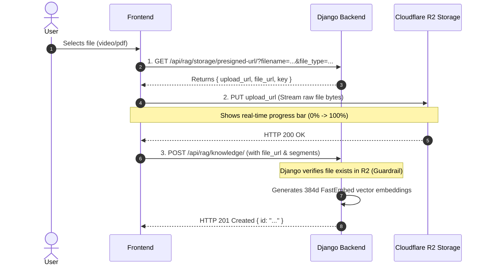

# Complete Frontend Integration Guide — Khemra RAG & AI Backend

This guide is the complete, definitive technical reference for the frontend team (Web, React, Next.js, Vue, Flutter, iOS, Android) integrating with the **Khemra Knowledge RAG & AI Overview Backend**.

---

## 1. Environment & Base URL Configuration

| Environment | Base URL |
| :--- | :--- |
| **Local Development** | `http://localhost:8000` |
| **Production API** | `https://api.yourdomain.com` *(or your production gateway)* |

All endpoints use standard JSON payloads (`Content-Type: application/json`), except direct file uploads to Cloudflare R2 which stream raw binary data (`PUT`).

---

## 2. All Backend Endpoints at a Glance

| Method | Endpoint Path | Description | Typical Frontend Screen |
| :--- | :--- | :--- | :--- |
| **`GET`** | `/api/rag/storage/presigned-url/` | Step 1: Obtains a temporary signed upload ticket to Cloudflare R2. | Admin / Creator Upload Modal |
| **`PUT`** | *`upload_url` from Step 1* | Step 2: Streams raw binary file directly to Cloudflare R2 storage. | File Upload Progress Bar |
| **`POST`** | `/api/rag/knowledge/` | Step 3: Saves knowledge metadata, chapters, and generates AI vectors. | Upload "Submit" Action |
| **`POST`** | `/api/rag/knowledge/search/ai-overview/` | **(Recommended)** AI Overview search: revised answer + sequential steps with `segment_id`. | Google-style Search / Chatbot |
| **`POST`** | `/api/rag/knowledge/search/` | Standard fast vector search (returns matched segments without LLM summary). | Fast Autocomplete / Quick Search |
| **`GET`** | `/api/rag/knowledge/:id/` | Fetches full document details, sources, and all segment chapters. | Document / Video Detail Player |

---

## 3. Workflow 1: Direct Cloudflare R2 File Upload

To keep the Django server fast and memory-efficient, files are **never** uploaded through Django. The frontend uploads directly to Cloudflare R2 in 3 strictly sequential steps:



### ⚠️ Critical Guardrail: The Anti-Ghost Rule
> **DO NOT CALL STEP 3 CONCURRENTLY WITH STEP 2.**  
> The backend contains an active guardrail: when `POST /api/rag/knowledge/` is called, it verifies that the file exists in Cloudflare R2. If you call Step 3 before Step 2 returns `200 OK`, or if Step 2 fails, the backend will reject the request with:
> ```json
> {
>   "sources": "Remote file at '...' does not exist (HTTP 404 Not Found). The file upload to Cloudflare R2 must complete successfully before submitting knowledge metadata."
> }
> ```

---

### Step 1: Request Presigned URL
* **URL:** `GET /api/rag/storage/presigned-url/`
* **Query Parameters:**
  - `filename` *(required)*: e.g. `onboarding.mp4` or `manual.pdf`
  - `file_type` *(required)*: MIME type, e.g. `video/mp4` or `application/pdf`
  - `file_size` *(optional)*: File size in bytes (e.g. `15000000`)
  - `folder` *(optional)*: `"videos"` or `"documents"` (default is `"documents"`)

**Response (`200 OK`):**
```json
{
  "upload_url": "https://<account-id>.r2.cloudflarestorage.com/bucket/videos/uuid.mp4?X-Amz-Signature=...",
  "file_url": "https://pub-d1cf39f6efc3465b9aff3a5e9d49aa54.r2.dev/videos/uuid.mp4",
  "key": "videos/uuid.mp4",
  "expires_in": 600
}
```

---

### Step 2: Upload File to Cloudflare R2
* **Method:** `PUT`
* **URL:** Use the `upload_url` from Step 1.
* **Headers:**
  - `Content-Type`: Must match the exact `file_type` passed in Step 1.
* **Body:** The raw `File` object (do NOT wrap in `FormData` or JSON).

---

### Step 3: Ingest Knowledge Metadata
* **URL:** `POST /api/rag/knowledge/`
* **Body:**
```json
{
  "title": "Company Onboarding & Tools Guide",
  "description": "Orientation guide for new employees.",
  "source_type": "video",
  "sources": [
    {
      "language": "en",
      "file_url": "https://pub-d1cf39f6efc3465b9aff3a5e9d49aa54.r2.dev/videos/uuid.mp4",
      "duration_seconds": 120.0
    }
  ],
  "segments": [
    {
      "segment_index": 0,
      "title": "Welcome and Core Values",
      "summary": "Introduction to the team and history.",
      "transcript": "Welcome to our company orientation program...",
      "keywords": ["welcome", "onboarding"],
      "possible_questions": ["What is covered in orientation?"],
      "start_time_seconds": 0.0,
      "end_time_seconds": 60.0
    },
    {
      "segment_index": 1,
      "title": "Workspace & Tools Setup",
      "summary": "Setting up Slack and contacting IT support.",
      "transcript": "Next, let's look at setting up your accounts, Slack, and email.",
      "keywords": ["slack", "it support", "accounts"],
      "possible_questions": ["How do I use Slack to talk to IT support?"],
      "start_time_seconds": 60.0,
      "end_time_seconds": 120.0
    }
  ]
}
```

**Response (`201 Created`):**
```json
{
  "id": "7c9e6679-7425-40de-944b-e07fc1f90ae7",
  "title": "Company Onboarding & Tools Guide",
  "source_type": "video",
  "processing_status": "completed",
  "segments_count": 2,
  "sources_count": 1
}
```

---

## 4. Workflow 2: AI Overview & Step-by-Step Search (Google Style)

### `POST /api/rag/knowledge/search/ai-overview/`

This is the primary user-facing search endpoint. It runs 4-signal vector search across indexed segments, and uses an LLM (**OpenAI GPT-OSS 120B on Groq**, `temperature: 0.1`) to revise the answer into a clear natural summary and ordered steps attached to `segment_id`.

### Request Payload:
```json
{
  "question": "How do I use Slack to talk to IT support?",
  "language": "en",
  "top_k": 3,
  "threshold": 0.10
}
```

| Parameter | Type | Default | Description |
| :--- | :--- | :---: | :--- |
| `question` | `string` | *Required* | User search query. |
| `language` | `string` | `"en"` | Language code (`"en"`, `"km"` for Khmer). Output summary and steps match this language. |
| `top_k` | `int` | `3` | Maximum number of segment cards to return (`1` to `50`). |
| `threshold` | `float` | `0.10` | Similarity cutoff score (`0.0` to `1.0`). |

---

### Response Payload Breakdown:
```json
{
  "question": "How do I use Slack to talk to IT support?",
  "language": "en",

  // 1. REVISED NATURAL SUMMARY (Generated by AI)
  "summary": "To talk to IT support using Slack, first set up your Slack account during onboarding, then join the designated support channel to message the team.",

  // 2. SEQUENTIAL ACTION STEPS (Generated by AI)
  "steps": [
    {
      "step_number": 1,
      "title": "Set up your Slack account",
      "instruction": "Follow onboarding instructions to create and configure your Slack account.",
      "segment_id": "d769ab39-cb24-496c-a005-96c3c724bd92"
    },
    {
      "step_number": 2,
      "title": "Contact IT support via Slack",
      "instruction": "Once Slack is set up, send a message to the IT support channel or direct message the IT team.",
      "segment_id": "d769ab39-cb24-496c-a005-96c3c724bd92"
    }
  ],

  "count": 1,
  "weights_used": {
    "topic": 0.20,
    "keyword": 0.20,
    "question": 0.35,
    "summary": 0.25
  },

  // 3. UNTOUCHED RETRIEVED SEGMENTS (For video player & cards)
  "results": [
    {
      "segment_id": "d769ab39-cb24-496c-a005-96c3c724bd92",
      "knowledge_id": "a0c32ab4-9807-43f7-a4e0-e959806cf1d9",
      "knowledge_title": "Company Onboarding & Tools Guide",
      "source_type": "video",
      "segment_index": 1,
      "title": "Workspace & Tools Setup",
      "summary": "Setting up communication tools, Slack channels, and contacting IT support.",
      "transcript": "Next, let's look at setting up your accounts, Slack, and email.",
      "start_time_seconds": 30.0,
      "end_time_seconds": 60.0,
      "page_start": null,
      "page_end": null,
      "score": 0.2929,
      "confidence": 29.29,
      "best_match": "summary",
      "matched_source": {
        "id": "ff43e6bd-17f8-4814-8060-c2f0486ec367",
        "language": "en",
        "file_url": "https://pub-d1cf39f6efc3465b9aff3a5e9d49aa54.r2.dev/videos/onboarding_en.mp4",
        "duration_seconds": 60.0,
        "is_fallback": false
      }
    }
  ]
}
```

---

## 5. UI Layout Design Guide: How Frontend Renders AI Overview

```text
┌────────────────────────────────────────────────────────────────────────┐
│  🔍 [ How do I use Slack to talk to IT support?                     ]   │
└────────────────────────────────────────────────────────────────────────┘

  ✨ AI Overview
  ┌────────────────────────────────────────────────────────────────────┐
  │  To talk to IT support using Slack, first set up your Slack account│
  │  during onboarding, then join the designated support channel to    │
  │  message the team.                                                 │
  │                                                                    │
  │  Key Steps:                                                        │
  │  [1] Set up your Slack account                            [▶ 0:30] │
  │      Follow onboarding instructions to configure Slack.            │
  │                                                                    │
  │  [2] Contact IT support via Slack                         [▶ 0:45] │
  │      Send a message to the IT support channel.                     │
  └────────────────────────────────────────────────────────────────────┘

  Matching Video & Document Sources (1 result found)
  ┌───────────────────────────────────┬────────────────────────────────┐
  │ 🎬 Company Onboarding Guide       │  [ Video Player: 0:30 - 1:00 ] │
  │ Chapter: Workspace & Tools Setup  │                                │
  │ Match Confidence: 85%             │  <video src="..." />           │
  │ "Next, let's look at setting..."  │                                │
  └───────────────────────────────────┴────────────────────────────────┘
```

### Linking Steps to Video Timestamp:
Each item in `steps` contains a `segment_id`. To jump the video player when a user clicks a step:

```javascript
function onStepClick(step, searchResults, videoPlayerRef) {
  // 1. Find the supporting segment in results
  const matchingSegment = searchResults.find(r => r.segment_id === step.segment_id);

  if (matchingSegment && matchingSegment.source_type === "video") {
    // 2. Set video URL
    videoPlayerRef.current.src = matchingSegment.matched_source.file_url;
    // 3. Jump to timestamp
    videoPlayerRef.current.currentTime = matchingSegment.start_time_seconds;
    videoPlayerRef.current.play();
  }
}
```

---

## 6. Ready-to-Use Frontend Client (TypeScript / JavaScript)

Here is a clean, production-ready API service module you can drop directly into your frontend project (`src/services/khemraApi.ts`):

```typescript
const BASE_URL = process.env.NEXT_PUBLIC_API_URL || "http://localhost:8000";

export interface StepItem {
  step_number: number;
  title: string;
  instruction: string;
  segment_id: string;
}

export interface MatchedSource {
  id: string;
  language: string;
  file_url: string;
  duration_seconds: number | null;
  page_count: number | null;
  is_fallback: boolean;
}

export interface SearchResultItem {
  segment_id: string;
  knowledge_id: string;
  knowledge_title: string;
  source_type: "video" | "pdf" | "text";
  segment_index: number;
  title: string | null;
  summary: string | null;
  transcript: string | null;
  start_time_seconds: number | null;
  end_time_seconds: number | null;
  page_start: number | null;
  page_end: number | null;
  score: number;
  confidence: number;
  matched_source: MatchedSource | null;
}

export interface AIOverviewResponse {
  question: string;
  language: string;
  summary: string | null;
  steps: StepItem[];
  count: number;
  results: SearchResultItem[];
}

export const khemraApi = {
  /**
   * Search knowledge with Google-style AI Overview and grounded steps
   */
  async searchAIOverview(
    question: string,
    language: string = "en",
    threshold: number = 0.10,
    top_k: number = 3
  ): Promise<AIOverviewResponse> {
    const res = await fetch(`${BASE_URL}/api/rag/knowledge/search/ai-overview/`, {
      method: "POST",
      headers: { "Content-Type": "application/json" },
      body: JSON.stringify({ question, language, threshold, top_k }),
    });

    if (!res.ok) {
      const err = await res.json();
      throw new Error(err.question || err.detail || "Search request failed");
    }

    return await res.json();
  },

  /**
   * 3-Step Direct Cloud Storage Upload
   */
  async uploadFileWithKnowledge(
    file: File,
    knowledgeData: {
      title: string;
      description?: string;
      source_type: "video" | "pdf" | "text";
      segments: Array<{
        segment_index: number;
        title: string;
        summary?: string;
        transcript?: string;
        start_time_seconds?: number;
        end_time_seconds?: number;
        page_start?: number;
        page_end?: number;
      }>;
    },
    onProgress?: (percent: number) => void
  ) {
    // 1. Get presigned upload URL
    const presignRes = await fetch(
      `${BASE_URL}/api/rag/storage/presigned-url/?filename=${encodeURIComponent(file.name)}&file_type=${encodeURIComponent(file.type)}&file_size=${file.size}`
    );
    if (!presignRes.ok) {
      const err = await presignRes.json();
      throw new Error(err.error || "Failed to obtain upload URL");
    }
    const { upload_url, file_url } = await presignRes.json();

    // 2. Upload file bytes to Cloudflare R2 via XMLHttpRequest for progress tracking
    await new Promise<void>((resolve, reject) => {
      const xhr = new XMLHttpRequest();
      xhr.open("PUT", upload_url, true);
      xhr.setRequestHeader("Content-Type", file.type);

      if (xhr.upload && onProgress) {
        xhr.upload.onprogress = (e) => {
          if (e.lengthComputable) {
            const percent = Math.round((e.loaded / e.total) * 100);
            onProgress(percent);
          }
        };
      }

      xhr.onload = () => {
        if (xhr.status >= 200 && xhr.status < 300) {
          resolve();
        } else {
          reject(new Error(`Storage upload failed with HTTP status ${xhr.status}`));
        }
      };

      xhr.onerror = () => reject(new Error("Network error during file upload to storage."));
      xhr.send(file);
    });

    // 3. Save knowledge metadata to Django backend
    const saveRes = await fetch(`${BASE_URL}/api/rag/knowledge/`, {
      method: "POST",
      headers: { "Content-Type": "application/json" },
      body: JSON.stringify({
        title: knowledgeData.title,
        description: knowledgeData.description,
        source_type: knowledgeData.source_type,
        sources: [{ language: "en", file_url: file_url }],
        segments: knowledgeData.segments,
      }),
    });

    if (!saveRes.ok) {
      const err = await saveRes.json();
      throw new Error(`Failed to save knowledge metadata: ${JSON.stringify(err)}`);
    }

    return await saveRes.json();
  },
};
```

---

## 7. Error Handling & Validation Matrix

When an error occurs, the backend returns **HTTP `400 Bad Request`** with actionable JSON messages:

| HTTP Status | Error Trigger | Error Response Pattern | Frontend Action |
| :---: | :--- | :--- | :--- |
| **`400`** | File not found in Cloudflare R2 (404) | `{"sources": "Remote file does not exist (HTTP 404 Not Found)..."}` | The R2 upload did not complete. Notify user to retry file upload. |
| **`400`** | Dangerous executable extension | `{"sources": "Forbidden file extension '.exe'..."}` | Block upload immediately in file picker. |
| **`400`** | Mismatched file extension vs type | `{"sources": "URL extension '.mp4' does not match source type 'pdf'..."}` | Ensure correct file type is selected. |
| **`400`** | Empty search question | `{"question": "Search question cannot be empty or whitespace only."}` | Disable search button when input is empty. |
| **`404`** | Knowledge ID not found | `{"detail": "Not found."}` | Redirect user to 404 / search page. |
| **`200`** | LLM timeout or offline | Returns `summary: null`, `steps: []`, `results: [...]` | Render results normally; hide the AI Overview card without erroring. |
