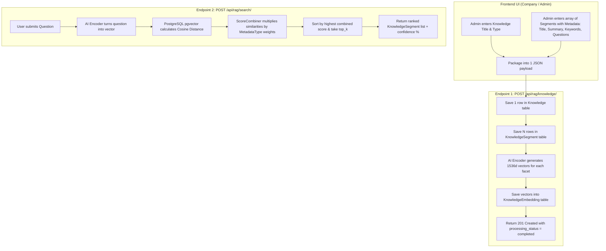

# Khemra RAG Platform: Architecture, Progress & Implementation Guide

**Date**: 2026-10-19  
**Status**: Models Updated & Design Completed — Ready for Endpoint Implementation  
**Repository Root**: `d:/Khemra Backend/my-django-dockerv2`

---

## 1. Executive Summary & Core Philosophy

This backend serves as a high-performance **Semantic Search / Vector Retrieval Engine** (the "R" in RAG) built with **Django 5.1**, **PostgreSQL**, and **pgvector**.

### The Core Division of Labor:
1. **The AI Model (`Encoder`)**:
   - Its **only** job is translating human text into vectors (lists of numbers).
   - It does *not* search the database, and it does *not* calculate similarities.
2. **The Database (`PostgreSQL` with `pgvector`)**:
   - Stores the high-dimensional vectors (`vector(1536)`).
   - Calculates the raw mathematical **Cosine Distance** between vectors directly in SQL.
3. **The Backend (`Django`)**:
   - Orchestrates ingestion: saves Knowledge, loops through the segment array, calls the AI to vectorize, and saves embeddings into DB.
   - Orchestrates search: turns questions into vectors, queries pgvector, applies weights across metadata types (`ScoreCombiner`), and returns the top-ranked segments with confidence scores.

---

## 2. System Architecture Flow



---

## 3. What Was Inherited vs. What Changed

| Area | Previous State (Inherited) | New State (Current) |
|---|---|---|
| **Domain Scope** | Only supported **Videos** | Supports **Video, PDF, and Text** |
| **Data Models** | `Video`, `VideoSegment`, `SegmentEmbedding` | `Knowledge`, `KnowledgeSource`, `KnowledgeSegment`, `MetadataType`, `KnowledgeEmbedding` |
| **Vector Dimensions** | 384 dimensions (`all-MiniLM-L6-v2`) | **1536 dimensions** (`vector(1536)`) |
| **Model Tracking** | Hardcoded | Stores `model_name` and `model_version` in DB |
| **Weight Scoring** | Hardcoded python choices | Dynamic database records in `MetadataType` table |
| **Model Files Status** | Old models deleted from disk | New models created in `apps/rag/models/` |

---

## 4. Current Database Schema (`apps/rag/models/`)

1. **[Knowledge.py](file:///d:/Khemra%20Backend/my-django-dockerv2/apps/rag/models/Knowledge.py)**:
   - Root document/item: `id` (UUID), `title`, `description`, `source_type` (`video`/`pdf`/`text`), `processing_status` (`pending`/`processing`/`completed`/`failed`), timestamps.
2. **[KnowledgeSource.py](file:///d:/Khemra%20Backend/my-django-dockerv2/apps/rag/models/KnowledgeSource.py)**:
   - Raw binary source storage: `knowledge_id`, `language`, `file_data` (bytea), `duration_seconds`, `page_count`.
   - Unique constraint: `(knowledge, language)`.
3. **[KnowledgeSegment.py](file:///d:/Khemra%20Backend/my-django-dockerv2/apps/rag/models/KnowledgeSegment.py)**:
   - Granular search chunks: `knowledge_id`, `segment_index`, `title`, `summary`, `transcript`, `keywords` (jsonb), `possible_questions` (jsonb), timestamps/page numbers.
   - Unique constraint: `(knowledge, segment_index)`.
4. **[MetadataType.py](file:///d:/Khemra%20Backend/my-django-dockerv2/apps/rag/models/MetadataType.py)**:
   - Category weights: `name` (unique: `title`, `summary`, `keywords`, `questions`), `weight` (float), `is_active` (bool).
5. **[KnowledgeEmbedding.py](file:///d:/Khemra%20Backend/my-django-dockerv2/apps/rag/models/KnowledgeEmbedding.py)**:
   - Vector table: `segment_id`, `metadata_type_id`, `item_index`, `embedding_vector` (`vector(1536)`), `model_name`, `model_version`.
   - Unique constraint: `(segment, metadata_type, item_index, model_name, model_version)`.

---

## 5. API Contracts (Payload Shapes)

### Ingestion Request: `POST /api/rag/knowledge/`
The company frontend sends 1 Knowledge item containing an array of segments:
```json
{
  "title": "2026 Company Leave Policy",
  "source_type": "text",
  "description": "Rules for annual PTO and sick days",
  "segments": [
    {
      "segment_index": 0,
      "title": "Annual Paid Time Off",
      "summary": "Full-time staff accrue 1.5 days/month, 18 days/year.",
      "transcript": "All permanent employees accrue 1.5 days...",
      "keywords": ["annual leave", "PTO", "vacation"],
      "possible_questions": [
        "How many leave days do I get?",
        "How does PTO accrue?"
      ],
      "start_time_seconds": 0.0,
      "end_time_seconds": 120.0
    },
    {
      "segment_index": 1,
      "title": "Sick Leave Protocol",
      "summary": "10 days paid sick leave with doctor note.",
      "transcript": "Sick leave covers medical absences...",
      "keywords": ["sick leave", "medical certificate"],
      "possible_questions": ["When is a doctor note required?"]
    }
  ]
}
```

### Search Request: `POST /api/rag/search/`
```json
{
  "question": "How do I take time off when I am sick?",
  "top_k": 3,
  "threshold": 0.30,
  "weights": {
    "questions": 0.40,
    "summary": 0.30,
    "title": 0.15,
    "keywords": 0.15
  }
}
```

### Search Response:
```json
{
  "question": "How do I take time off when I am sick?",
  "count": 1,
  "results": [
    {
      "knowledge_id": "7b8e1f5c-890a-428e-8a21-432851910245",
      "segment_id": "4d1a3c7e-9081-4235-8651-789a1b2c3d4e",
      "segment_index": 1,
      "title": "Sick Leave Protocol",
      "summary": "10 days paid sick leave with doctor note.",
      "score": 0.812,
      "confidence": 81.20,
      "best_match": "questions",
      "confidence_by_type": {
        "questions": 89.4,
        "summary": 78.1,
        "title": 68.5,
        "keywords": 72.3
      }
    }
  ]
}
```

---

## 6. Project Artifacts & Documentation Map

- **Active Feature Directory**: `specs/001-knowledge-rag-api/`
- **Feature Specification**: [specs/001-knowledge-rag-api/spec.md](file:///d:/Khemra%20Backend/my-django-dockerv2/specs/001-knowledge-rag-api/spec.md)
- **Implementation Plan**: [specs/001-knowledge-rag-api/plan.md](file:///d:/Khemra%20Backend/my-django-dockerv2/specs/001-knowledge-rag-api/plan.md)
- **Data Model Specs**: [specs/001-knowledge-rag-api/data-model.md](file:///d:/Khemra%20Backend/my-django-dockerv2/specs/001-knowledge-rag-api/data-model.md)
- **API Contracts**:
  - Upload: [contracts/knowledge-upload.json](file:///d:/Khemra%20Backend/my-django-dockerv2/specs/001-knowledge-rag-api/contracts/knowledge-upload.json)
  - Search: [contracts/knowledge-search.json](file:///d:/Khemra%20Backend/my-django-dockerv2/specs/001-knowledge-rag-api/contracts/knowledge-search.json)
  - Detail: [contracts/knowledge-detail.json](file:///d:/Khemra%20Backend/my-django-dockerv2/specs/001-knowledge-rag-api/contracts/knowledge-detail.json)
- **Quickstart Runnable Guide**: [specs/001-knowledge-rag-api/quickstart.md](file:///d:/Khemra%20Backend/my-django-dockerv2/specs/001-knowledge-rag-api/quickstart.md)
- **Executable Tasks**: [specs/001-knowledge-rag-api/tasks.md](file:///d:/Khemra%20Backend/my-django-dockerv2/specs/001-knowledge-rag-api/tasks.md)

---

## 7. Next Steps: Roadmap for Backend Endpoint Implementation

Follow these sequential steps to implement the revised backend:

### Step 1: Database Migration & Metadata Seeding
- [ ] Run `python manage.py makemigrations rag` to create migration files for the new models.
- [ ] Run `python manage.py migrate` to apply tables to PostgreSQL.
- [ ] Seed standard `MetadataType` rows:
  - `title` (weight: 0.20)
  - `summary` (weight: 0.25)
  - `keywords` (weight: 0.20)
  - `questions` (weight: 0.35)

### Step 2: Embedding Infrastructure Updates
- [ ] Update [Encoder.py](file:///d:/Khemra%20Backend/my-django-dockerv2/apps/rag/encoder/Encoder.py) and [FakeEncoder.py](file:///d:/Khemra%20Backend/my-django-dockerv2/apps/rag/tests/FakeEncoder.py) to output **1536 dimensions** matching `KnowledgeEmbedding`.
- [ ] Update [EmbeddingTextBuilder.py](file:///d:/Khemra%20Backend/my-django-dockerv2/apps/rag/services/EmbeddingTextBuilder.py) to read from `KnowledgeSegment` dictionary/object attributes and tag them with `MetadataType`.

### Step 3: Implement Knowledge Ingestion Service & API (`POST /api/rag/knowledge/`)
- [ ] Create `apps/rag/serializers/KnowledgeInputSerializer.py` (validates `title`, `source_type`, and the `segments` array).
- [ ] Create `apps/rag/services/KnowledgeIngestService.py`:
  - Starts transaction.
  - Saves `Knowledge` header.
  - Bulk saves `KnowledgeSegment` items.
  - Vectorizes all facets via `Encoder`.
  - Bulk creates `KnowledgeEmbedding` rows.
  - Updates status to `completed`.
- [ ] Create `apps/rag/views/KnowledgeUploadAPI.py` handling `POST /api/rag/knowledge/`.

### Step 4: Implement Semantic Question Search Service & API (`POST /api/rag/search/`)
- [ ] Update `ScoreCombiner.py` to use dynamic weights from `MetadataType` table.
- [ ] Create `apps/rag/services/KnowledgeSearchService.py`:
  - Vectorizes question.
  - Queries `KnowledgeEmbedding` using `CosineDistance`.
  - Combines weighted scores via `ScoreCombiner`.
  - Filters by `threshold` and slices to `top_k`.
  - Bulk fetches matching `KnowledgeSegment` objects.
- [ ] Create `apps/rag/serializers/KnowledgeSearchRequestSerializer.py`.
- [ ] Create `apps/rag/views/KnowledgeSearchAPI.py` handling `POST /api/rag/search/`.

### Step 5: Wire URLs & Run End-to-End Validation
- [ ] Update [apps/rag/urls.py](file:///d:/Khemra%20Backend/my-django-dockerv2/apps/rag/urls.py):
  - `path("knowledge/", KnowledgeUploadAPI.as_view(), name="knowledge-upload")`
  - `path("search/", KnowledgeSearchAPI.as_view(), name="knowledge-search")`
- [ ] Execute test scenarios from [specs/001-knowledge-rag-api/quickstart.md](file:///d:/Khemra%20Backend/my-django-dockerv2/specs/001-knowledge-rag-api/quickstart.md) using `curl`.
- [ ] Run full test suite: `python manage.py test apps.rag`.
