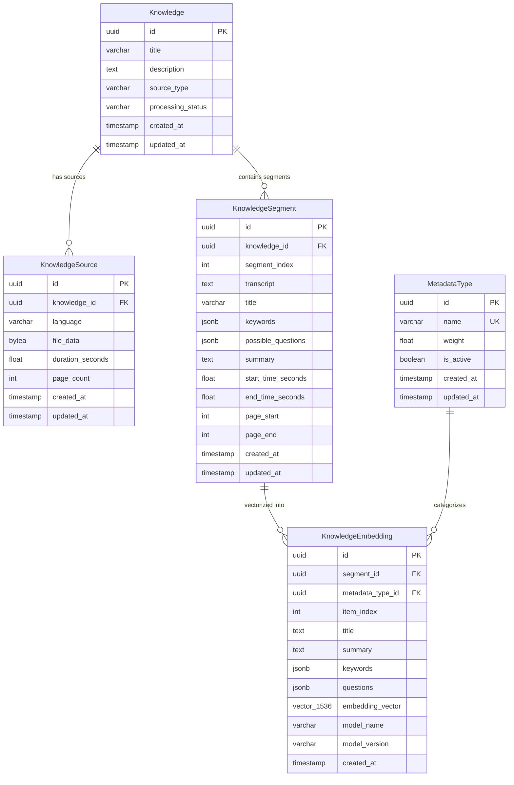
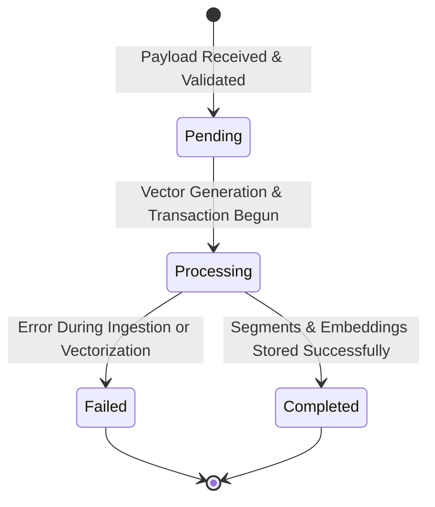

# Data Model: Knowledge RAG Architecture

**Feature**: [spec.md](./spec.md) | **Plan**: [plan.md](./plan.md)  
**Date**: 2026-10-19

## Overview

The RAG data architecture stores multi-modal knowledge records, raw binary source files, granular content segments, metadata categorization types, and high-dimensional vector embeddings in PostgreSQL with pgvector.

---

## Entity Relationship Diagram

---

## Entities & Field Specifications

### 1. `Knowledge`
- **Table**: `knowledge`
- **Primary Key**: `id` (UUID, auto-generated)
- **Fields**:
  - `title`: `VARCHAR(500)`, required.
  - `description`: `TEXT`, optional.
  - `source_type`: `VARCHAR(20)`, required. Choices: `video`, `pdf`, `text`.
  - `processing_status`: `VARCHAR(20)`, required. Choices: `pending`, `processing`, `completed`, `failed`. Default: `pending`.
  - `created_at`: `TIMESTAMP`, auto-populated on creation.
  - `updated_at`: `TIMESTAMP`, auto-updated on modification.
- **Validation**:
  - `title` cannot be blank or whitespace only.
  - `source_type` must be in allowed choices.

### 2. `KnowledgeSource`
- **Table**: `knowledge_sources`
- **Primary Key**: `id` (UUID, auto-generated)
- **Fields**:
  - `knowledge_id`: `UUID`, Foreign Key to `knowledge.id`, `ON DELETE CASCADE`.
  - `language`: `VARCHAR(10)`, required (e.g. `en`, `kh`).
  - `file_data`: `BYTEA` / `BinaryField`, required binary file content.
  - `duration_seconds`: `FLOAT`, optional (for audio/video sources).
  - `page_count`: `INTEGER`, optional (for PDF/document sources).
  - `created_at`: `TIMESTAMP`, auto-populated.
  - `updated_at`: `TIMESTAMP`, auto-updated.
- **Constraints**:
  - Unique constraint: `(knowledge_id, language)` — only one file per language per knowledge item.

### 3. `KnowledgeSegment`
- **Table**: `knowledge_segments`
- **Primary Key**: `id` (UUID, auto-generated)
- **Fields**:
  - `knowledge_id`: `UUID`, Foreign Key to `knowledge.id`, `ON DELETE CASCADE`.
  - `segment_index`: `INTEGER`, required, 0-indexed sequence of the segment.
  - `transcript`: `TEXT`, optional full transcript or content block.
  - `title`: `VARCHAR(500)`, optional segment-level headline/topic.
  - `keywords`: `JSONB`, optional list of keyword strings.
  - `possible_questions`: `JSONB`, optional list of user-facing questions.
  - `summary`: `TEXT`, optional concise summary.
  - `start_time_seconds`: `FLOAT`, optional segment start timestamp.
  - `end_time_seconds`: `FLOAT`, optional segment end timestamp.
  - `page_start`: `INTEGER`, optional start page number.
  - `page_end`: `INTEGER`, optional end page number.
  - `created_at`: `TIMESTAMP`, auto-populated.
  - `updated_at`: `TIMESTAMP`, auto-updated.
- **Constraints**:
  - Unique constraint: `(knowledge_id, segment_index)`.

### 4. `MetadataType`
- **Table**: `metadata_types`
- **Primary Key**: `id` (UUID, auto-generated)
- **Fields**:
  - `name`: `VARCHAR(50)`, unique (e.g., `title`, `summary`, `keywords`, `questions`).
  - `weight`: `FLOAT`, positive decimal weight (e.g., `0.35`).
  - `is_active`: `BOOLEAN`, default `true`.
  - `created_at`: `TIMESTAMP`, auto-populated.
  - `updated_at`: `TIMESTAMP`, auto-updated.
- **Default Seed Records**:
  - `title` (weight: 0.20, active: true)
  - `summary` (weight: 0.25, active: true)
  - `keywords` (weight: 0.20, active: true)
  - `questions` (weight: 0.35, active: true)

### 5. `KnowledgeEmbedding`
- **Table**: `knowledge_embeddings`
- **Primary Key**: `id` (UUID, auto-generated)
- **Fields**:
  - `segment_id`: `UUID`, Foreign Key to `knowledge_segments.id`, `ON DELETE CASCADE`.
  - `metadata_type_id`: `UUID`, Foreign Key to `metadata_types.id`, `ON DELETE CASCADE`.
  - `item_index`: `INTEGER`, 0 for single items (title, summary), 0..N for multi-item fields (keywords, questions).
  - `title`: `TEXT`, populated when embedding title.
  - `summary`: `TEXT`, populated when embedding summary.
  - `keywords`: `JSONB`, populated with `{text, vector}` list when embedding keywords.
  - `questions`: `JSONB`, populated with `{text, vector}` list when embedding questions.
  - `embedding_vector`: `vector(1536)`, PostgreSQL pgvector field.
  - `model_name`: `VARCHAR(100)`, model identifier used for vectorization.
  - `model_version`: `VARCHAR(100)`, version of the model.
  - `created_at`: `TIMESTAMP`, auto-populated.
- **Indexes & Constraints**:
  - Unique constraint: `(segment_id, metadata_type_id, item_index, model_name, model_version)`.
  - Index: `(segment_id, metadata_type_id)`.

---

## State Transitions: Knowledge Ingestion Lifecycle

