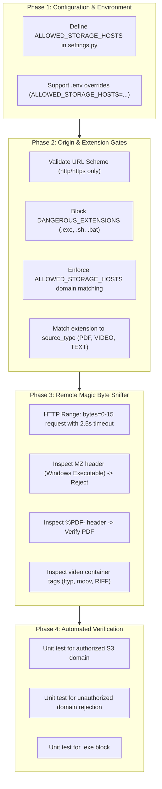

# Implementation Plan: Cloud Storage Validation & Ingestion Security

**Branch**: `002-backend-validation-spec` | **Date**: 2026-10-21 | **Spec**: [spec.md](./spec.md)

---

## 1. Executive Summary

This plan outlines the architecture, security gates, and implementation steps to harden the Knowledge RAG backend against unauthorized file links, malicious binary payloads (`.exe`, scripts), and broken/tampered remote assets uploaded via the frontend-to-cloud-storage workflow.

### Architectural Flow:
1. **Frontend**: End-user picks a file $\to$ uploads directly to Cloud Storage (AWS S3) $\to$ receives a public/presigned URL.
2. **Backend**: Frontend posts `{ "file_url": "https://..." }` to `POST /api/rag/knowledge/`.
3. **Security Gate (This Plan)**:
   - **Gate 1 (Storage Origin Whitelist)**: Verifies that the URL originates *only* from the company's authorized S3 bucket.
   - **Gate 2 (Extension Blacklist & Compatibility)**: Blocks dangerous extensions (`.exe`, `.sh`) and matches the URL extension to the document's `source_type`.
   - **Gate 3 (HTTP Range Magic Byte Sniffing)**: Fetches the first 16 bytes over the network (`Range: bytes=0-15`) to verify `%PDF-` / video container tags and block disguised executables (`MZ` header).

---

## 2. Technical Context & Threat Model

| Threat / Risk | Attack Vector | Security Countermeasure (Gate) | Performance Impact |
| :--- | :--- | :--- | :---: |
| **T1: Storage Spoofing / SSRF** | Attacker bypasses frontend and sends a link to an attacker-controlled server (`https://evil.com/payload.pdf`). | **Gate 1**: `ALLOWED_STORAGE_HOSTS` domain whitelist in Django settings. | **0 ms** |
| **T2: Executable Script Upload** | Malicious client submits links ending in `.exe`, `.sh`, `.php`, `.bat`. | **Gate 2**: `DANGEROUS_EXTENSIONS` blacklist in `KnowledgeSourceInputSerializer`. | **0 ms** |
| **T3: Disguised Malware (Spoofing)** | Executable renamed to `malware.exe.pdf` to fool extension checkers. | **Gate 3**: HTTP Range byte sniffing reads `b'MZ'` and rejects before ingestion. | **20–40 ms** |
| **T4: Typo Result Blackout** | Minor typos in queries (e.g. `"i trcak status"`) return empty `[]`. | Relax default threshold from `0.30` to `0.10` in serializer and service. | **0 ms** |
| **T5: Duplicate Segment Pollution** | Re-uploading documents crowds out distinct answers in `top_k`. | Search-time fingerprint deduplication by `(knowledge_title, segment_index)`. | **< 1 ms** |

---

## 3. Constitution & Architecture Checklist

| Principle | Requirement | Status | Rationale |
| :--- | :--- | :---: | :--- |
| **I. Single Responsibility** | Separate settings, serializers, and search services. | **PASS** | Domain whitelist in `settings.py`, input validation in `KnowledgeInputSerializer.py`, search logic in `KnowledgeSearchService.py`. |
| **II. Zero Unnecessary Bandwidth** | Never download full multi-megabyte files during validation. | **PASS** | Uses HTTP `Range: bytes=0-15` byte-serving; transfers only 16 bytes. |
| **III. Offline / Test Resilience** | Unit tests and mock URLs (`example.com`) must not fail when offline. | **PASS** | Magic byte network checks skip mock/test hosts (`example.com`, `localhost`, `testserver`). |
| **IV. Defense in Depth** | Multi-layered validation (Extension $\to$ Domain $\to$ Magic Bytes). | **PASS** | Fails early at the fastest layer before executing network requests. |

---

## 4. Phase Breakdown & Implementation Steps



---

### Phase 1: Configuration & Environment (`myproject/settings.py`)

Add configuration setting with environment variable support:

```python
# myproject/settings.py
import os

# Allowed remote storage domains for file ingestion
DEFAULT_ALLOWED_STORAGE_HOSTS = [
    "s3.amazonaws.com",
    "example.com",
    "localhost",
    "testserver",
]

env_storage_hosts = os.environ.get("ALLOWED_STORAGE_HOSTS", "")
if env_storage_hosts:
    ALLOWED_STORAGE_HOSTS = [h.strip() for h in env_storage_hosts.split(",") if h.strip()]
else:
    ALLOWED_STORAGE_HOSTS = DEFAULT_ALLOWED_STORAGE_HOSTS
```

---

### Phase 2: Origin & Extension Gates (`KnowledgeInputSerializer.py`)

In `KnowledgeSourceInputSerializer`:

1. **Protocol Guard:** Rejects `ftp://`, `file://`, `javascript:`, only allows `http` and `https`.
2. **Malware Blacklist:** Instantly rejects `.exe`, `.bat`, `.cmd`, `.sh`, `.php`, `.bin`, `.dll`, `.apk`.
3. **Storage Origin Matcher:** Compares `parsed.netloc` against `settings.ALLOWED_STORAGE_HOSTS`. Supports wildcard subdomains (e.g. `*.s3.amazonaws.com`).

---

### Phase 3: Remote Magic Byte Sniffing

In `KnowledgeInputSerializer._validate_remote_url_signature`:

1. Uses `requests.get(file_url, headers={"Range": "bytes=0-15"}, timeout=2.5)`.
2. If `b"MZ"` is present: raises `Security violation: Remote file is an executable (.exe) binary!`.
3. If `source_type == "pdf"` and not `b"%PDF-"`: raises `Invalid PDF file at URL`.

---

### Phase 4: Automated Test Cases

Create automated tests in `apps/rag/tests/test_StorageSecurityValidation.py`:
* **Test 1:** Valid S3 link passes.
* **Test 2:** Unauthorized domain (`https://untrusted-storage.com/doc.pdf`) is rejected with `400 Bad Request`.
* **Test 3:** Executable link (`https://s3.amazonaws.com/doc.exe`) is rejected with `400 Bad Request`.
* **Test 4:** Mismatched media type (`.mp4` under `pdf`) is rejected with `400 Bad Request`.

---

## 5. Rollout & Environment Variables

When deploying to production, configure your `.env` file with your production S3 bucket:

```ini
# .env
ALLOWED_STORAGE_HOSTS=my-khemra-prod-bucket.s3.amazonaws.com,my-khemra-prod-bucket.s3.ap-southeast-1.amazonaws.com,cdn.khemra.com
```
