# Feature Specification: Backend Business Logic & Validation Rules

**Feature Branch**: `002-backend-validation-spec`  
**Created**: 2026-10-21  
**Status**: Approved / Implemented  
**Target Audience**: Developers, QA Engineers, Product Managers, Frontend Integrators  

---

## 1. Executive Summary & Business Goals

The **Knowledge RAG (Retrieval-Augmented Generation) Backend** acts as the central AI knowledge engine for chatbots, search portals, and mobile apps. It ingests enterprise documents (PDFs, Videos, Text manuals) and allows users to ask natural language questions to find the exact video timestamps, document pages, or text answers they need.

### The Business Problems This Specification Solves:
1. **Garbage In, Garbage Out**: If corrupted files or broken time-ranges enter the database, the AI chatbot will give broken answers to users.
2. **Security & File Spoofing**: Prevents malicious users from renaming an `.exe` file to `.pdf` or uploading corrupt Base64 data.
3. **Empty Results from Typo Queries**: With pure vector search, minor spelling errors (e.g., *"i trcak status"*) can cause the search engine to return nothing. Calibrated thresholds prevent user drop-off.
4. **Duplicate Spam / Crowding Out**: When documents are uploaded multiple times or updated with new chapters, duplicate segments must not crowd out other relevant answers in the `top_k` results.

---

## 2. Core Business Workflows & Logic

```mermaid
graph TD
    subgraph Ingestion ["Workflow 1: Knowledge Ingestion"]
        Upload["Client uploads Knowledge (PDF/Video/Text)"]
        ValHeader["Validate Title & Source Type"]
        ValBytes["Magic Byte File Verification (%PDF-, MP4, UTF-8)"]
        ValSegs["Validate Segments (Timestamps & Chronology)"]
        SaveDB["Atomic Database Transaction & Vector Embeddings"]
        Upload --> ValHeader --> ValBytes --> ValSegs --> SaveDB
    end

    subgraph Search ["Workflow 2: Search & Smart Deduplication"]
        Query["User Query: 'i trcak status'"]
        Embed["Generate Query Vector (MiniLM)"]
        Cosine["Cosine Distance per Segment & Metadata Signal"]
        ThresholdGate["Quality Gate (Score >= 0.10)"]
        Dedup["Smart Deduplication (Knowledge Title + Segment Index)"]
        LangMatch["Multi-Language Source Resolution"]
        FinalResults["Top K Unique Ranked Results to Chatbot/UI"]

        Query --> Embed --> Cosine --> ThresholdGate --> Dedup --> LangMatch --> FinalResults
    end
```



---

## 3. Business Validation Rules Matrix

### Module A: Document & Media Ingestion (`POST /api/rag/knowledge/`)

| Business Rule | Why We Need It (Business Intent) | What Gets Tested / Evaluated | Outcome If Invalid |
| :--- | :--- | :--- | :--- |
| **BR-ING-01: Meaningful Title** | Every document must be identifiable in search results and UI lists. | `title.strip() != ""` and `len(title) <= 500` | Rejects with `400 Bad Request`: *"Title cannot be empty or whitespace only."* |
| **BR-ING-02: Valid Media Type** | The system must know how to parse the content. | `source_type in ['pdf', 'video', 'text']` | Rejects with `400 Bad Request`: Invalid choice. |
| **BR-ING-03: Minimum One Segment** | A document without content cannot be indexed for search. | At least 1 item in `segments` or `knowledge_segments`. | Rejects with `400 Bad Request`: *"At least one segment must be provided."* |
| **BR-ING-04: Unique Languages** | A document cannot have two English source files or two Khmer files. | `len(languages) == len(set(languages))` | Rejects with `400 Bad Request`: *"Duplicate languages found in sources."* |
| **BR-ING-05: Non-Conflicting Segment Index** | Segments represent sequential chapters or pages (0, 1, 2, ...). | `len(indices) == len(set(indices))` | Rejects with `400 Bad Request`: *"Duplicate segment_index found."* |
| **BR-ING-06: Chronological Video Timestamps** | A video clip cannot end before it begins. | `start_time_seconds <= end_time_seconds` | Rejects with `400 Bad Request`: *"start_time_seconds cannot be greater than end_time_seconds"* |
| **BR-ING-07: Chronological Page Numbers** | A PDF section cannot end on page 5 if it starts on page 10. | `page_start <= page_end` | Rejects with `400 Bad Request`: *"page_start cannot be greater than page_end"* |
| **BR-ING-08: Base64 Binary Integrity** | Uploaded file data must not be corrupted during transmission. | Decodes Base64 string with strict validation. | Rejects with `400 Bad Request`: *"Invalid base64 encoded binary data"* |
| **BR-ING-09: Magic Byte File Verification** | Prevents file extension spoofing (e.g. uploading a renamed script as a PDF). | Inspects initial file header bytes: <br>• **PDF**: must start with `%PDF-`<br>• **Video**: must contain `ftyp`, `moov`, `RIFF/AVI`, or `MKV`<br>• **Text**: must be valid UTF-8/UTF-16 | Rejects with `400 Bad Request`: *"Invalid file format for language 'X'. Header does not match."* |

---

### Module B: Search & Quality Filtering (`POST /api/rag/knowledge/search/`)

| Business Rule | Why We Need It (Business Intent) | What Gets Tested / Evaluated | Outcome If Invalid / Fallback |
| :--- | :--- | :--- | :--- |
| **BR-SCH-01: Non-Empty Query** | The search engine needs text to compute semantic embeddings. | `question.strip() != ""` | Rejects with `400 Bad Request`: *"Search question cannot be empty."* |
| **BR-SCH-02: Result Volume Control** | Prevents overwhelming client apps and mobile bandwidth. | `1 <= top_k <= 50` (Default: `3`) | Rejects if out of bounds; defaults to 3. |
| **BR-SCH-03: Quality Cutoff Threshold** | Prevents returning irrelevant answers when a user asks random questions. | Similarity score $\ge \text{threshold}$ (Default: `0.10`). | Results with score $< 0.10$ are dropped from output. |
| **BR-SCH-04: Typo & Loose Matching Tolerance** | Users on mobile often make typos (e.g., *"i trcak status"*). | With threshold at `0.10`, queries with minor typos scoring ~`0.21` successfully pass through. | Returns the best matching segments instead of empty `[]`. |
| **BR-SCH-05: Search-Time Deduplication** | Re-uploading a document or having updated versions must not crowd out distinct answers. | Checks `(knowledge_title, segment_index)` and `(title, snippet)`. | Duplicate segments are collapsed; slot is saved for the next best distinct answer. |
| **BR-SCH-06: Same-Source Multi-Segment Suggestion** | A single long video can have multiple chapters that answer different parts of the user's question. | Segments with different `segment_index` from the same document are **preserved**. | Both Chapter 1 and Chapter 2 appear in the results list. |
| **BR-SCH-07: Multi-Language Fallback** | Users should always get a playable media link even if their specific dialect source file is missing. | 1. Match requested language.<br>2. Fallback to English.<br>3. Fallback to first available source. | Sets `matched_source` with `is_fallback: true/false`. |

---

## 4. User Scenarios & Acceptance Criteria (Gherkin Format)

### Scenario 1: Uploading a Valid Video Knowledge Item with Multi-language Sources
```gherkin
Given a content admin submits a POST request to "/api/rag/knowledge/"
And the payload contains:
  | title        | "Company Onboarding & Welcome Orientation" |
  | source_type  | "video"                                    |
  | sources      | 1 English MP4 file, 1 Khmer MP4 file       |
  | segments     | 2 segments with valid start and end times  |
When the request is processed
Then the system returns HTTP 201 Created
And the response contains the new knowledge ID and status "completed"
And vector embeddings are generated for keywords, questions, summaries, and topics.
```

### Scenario 2: Rejecting a PDF with Invalid Magic Bytes (Security Check)
```gherkin
Given a user attempts to upload a PDF document
And the file bytes do not begin with "%PDF-" (e.g., a renamed plain text file)
When the request is submitted to "/api/rag/knowledge/"
Then the system rejects the transaction with HTTP 400 Bad Request
And the response message states: "Invalid PDF file format... File header does not match PDF format ('%PDF-')."
And no database rows are created.
```

### Scenario 3: Searching with a Typo ("i trcak status")
```gherkin
Given indexed segments on order tracking exist in the database
When a user submits POST "/api/rag/knowledge/search/" with:
  | question  | "i trcak status" |
  | threshold | 0.10             |
  | top_k     | 3                |
Then the similarity score is evaluated as ~0.2103
And because 0.2103 >= 0.10, the matching segment is NOT filtered out
And the user receives HTTP 200 OK with the relevant tracking segment.
```

### Scenario 4: Preventing Duplicate Segments from Stealing top_k Slots
```gherkin
Given the document "Company Onboarding" was uploaded twice under different IDs
And both copies contain Segment 1: "Workspace & Tools Setup"
When a user searches for tools setup with top_k = 3
Then the search deduplication filter identifies the duplicate key ("company onboarding", 1)
And Segment 1 appears only ONCE in the results
And the remaining 2 slots are filled by other distinct segments (e.g., "Introduction & Welcome").
```

### Scenario 5: Allowing Multiple Different Chapters from the Same Source
```gherkin
Given a single video "Company Onboarding" has:
  | Segment 0 | "Introduction & Welcome"    |
  | Segment 1 | "Workspace & Tools Setup"   |
When a user submits a broad search query matching both topics
Then the search engine evaluates both segments
And because their segment indices differ (0 vs 1), NEITHER is treated as a duplicate
And BOTH segments appear in the search results.
```

---

## 5. Test Suite & Verification Commands

All business rules defined in this specification are verified via automated tests:

### Running Search & Deduplication Tests:
```bash
docker compose exec -T web python manage.py test apps.rag.tests.test_KnowledgeSearchService
```
*Expected Result:* `4 tests in ~0.10s — OK`

### Running Ingestion & Validation Tests:
```bash
docker compose exec -T web python manage.py test apps.rag.tests.test_KnowledgeIngestService
```

---

## 6. Code Artifacts Supporting This Spec

* **Validation Rules Implementation:**
  * [KnowledgeInputSerializer.py](file:///d:/Khemra%20Backend/my-django-dockerv2/apps/rag/serializers/KnowledgeInputSerializer.py) — Ingestion validation, Base64 checks, and file magic bytes.
  * [KnowledgeSearchRequestSerializer.py](file:///d:/Khemra%20Backend/my-django-dockerv2/apps/rag/serializers/KnowledgeSearchRequestSerializer.py) — Query validation and default threshold `0.10`.
* **Business Logic & Deduplication:**
  * [KnowledgeSearchService.py](file:///d:/Khemra%20Backend/my-django-dockerv2/apps/rag/services/KnowledgeSearchService.py) — Search execution, scoring, quality threshold cutoff, and segment deduplication.
  * [KnowledgeIngestService.py](file:///d:/Khemra%20Backend/my-django-dockerv2/apps/rag/services/KnowledgeIngestService.py) — Multi-facet vector embedding pipeline.
