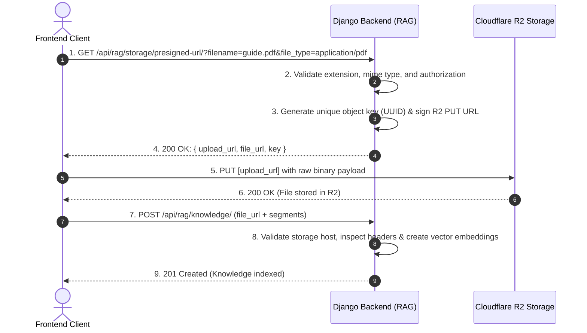

# Feature Specification: Cloudflare R2 Presigned Direct Upload

**Feature Branch**: `003-r2-presigned-upload`  
**Created**: 2026-10-21  
**Status**: Draft / Ready for Review  
**Input**: "do me the implementation plan of the presigned URL thing. wrtie the spec and the plan using speckkit"

---

## 1. Executive Summary & User Scenarios

### Overview
The **Cloudflare R2 Presigned Upload** feature allows clients (Web, Mobile, Admin CMS) to upload large media files (PDF documents, training videos, audio transcripts) directly to Cloudflare R2 object storage without streaming heavy binary payloads through the Django web application server.

By generating short-lived, cryptographically signed HTTP `PUT` URLs on the backend, the system eliminates web worker starvation, prevents out-of-memory errors on Django, avoids expensive egress fees, and guarantees strict separation of concerns between binary storage and knowledge metadata ingestion.

---

## 2. Prioritized User Stories

### User Story 1 - Requesting a Presigned Upload URL (Priority: P1)
As an authenticated admin or content contributor, I want to request a temporary presigned upload URL for a specific document or video, so that I can securely upload my file directly to cloud storage without sharing master cloud credentials.

**Why this priority**: Without this endpoint, the client cannot upload files directly to Cloudflare R2, leaving only unscalable base64 or server-proxy upload methods.

**Independent Test**: The endpoint can be independently tested via HTTP GET with query parameters `filename` and `file_type`. It returns valid `upload_url` and `file_url` strings within $< 50\text{ms}$.

**Acceptance Scenarios**:
1. **Given** a valid filename (`handbook.pdf`) and MIME type (`application/pdf`), **When** the client sends `GET /api/rag/storage/presigned-url/?filename=handbook.pdf&file_type=application/pdf`, **Then** the backend returns HTTP 200 with a cryptographically signed `upload_url` expiring in 10 minutes, a public `file_url`, and the generated unique object key.
2. **Given** a valid video filename (`training.mp4`) and MIME type (`video/mp4`), **When** the client requests a presigned URL, **Then** the backend returns an upload URL configured for video content.

---

### User Story 2 - Pre-Upload Malware & Extension Gatekeeping (Priority: P1)
As a platform security administrator, I want the presigned URL endpoint to reject dangerous executable extensions (`.exe`, `.bat`, `.sh`, `.php`, etc.) before any upload ticket is issued, so that untrusted users cannot use our storage bucket to host malware.

**Why this priority**: Preventing malicious files at the presigned URL phase prevents unauthorized users from even writing malicious binaries to the bucket.

**Independent Test**: Requesting a presigned URL for `trojan.exe` or `exploit.sh` immediately returns HTTP 400 Bad Request with a clear security rejection error.

**Acceptance Scenarios**:
1. **Given** a filename with an executable or script extension (e.g. `malware.exe`), **When** requesting a presigned URL, **Then** the backend returns HTTP 400 with `"Forbidden file extension '.exe'."`
2. **Given** a filename with no extension or missing parameters, **When** requesting a presigned URL, **Then** the backend returns HTTP 400 with a descriptive validation error.

---

### User Story 3 - Collision-Free and Non-Guessable Object Keying (Priority: P2)
As a platform operator, I want uploaded files to be stored under unique, non-guessable storage paths (using UUIDs), so that multiple users uploading files with identical names (e.g., `document.pdf`) never overwrite or corrupt each other's data.

**Why this priority**: Preserves document integrity and prevents race conditions or data leakage across multiple tenants.

**Independent Test**: Two successive requests for the same filename `notes.pdf` produce distinct, randomized object keys.

**Acceptance Scenarios**:
1. **Given** two users upload `invoice.pdf`, **When** presigned URLs are issued, **Then** each URL targets a distinct key (e.g. `documents/<uuid-1>.pdf` and `documents/<uuid-2>.pdf`).

---

### User Story 4 - Seamless Handshake with Knowledge Ingestion (Priority: P1)
As an API integrator, I want the `file_url` generated by the presigned endpoint to be 100% compliant with the existing `POST /api/rag/knowledge/` validation rules, so that after uploading to R2, ingestion succeeds without domain whitelist or format errors.

**Why this priority**: Connects the upload phase to the existing RAG vector pipeline.

**Independent Test**: Taking the returned `file_url`, uploading a valid PDF to R2, and submitting `POST /api/rag/knowledge/` results in HTTP 201 Created and successful vector indexing.

**Acceptance Scenarios**:
1. **Given** a file successfully uploaded to Cloudflare R2 via `upload_url`, **When** the client submits `POST /api/rag/knowledge/` with that `file_url`, **Then** the existing backend validation verifies the domain against `ALLOWED_STORAGE_HOSTS`, confirms magic bytes over HTTP Range, and returns 201 Created.

---

## 3. Edge Cases & Failure Modes

1. **Missing Query Parameters**:
   - `GET /api/rag/storage/presigned-url/` without `filename` or `file_type` $\to$ Returns `400 Bad Request`.
2. **Path Traversal in Filename**:
   - Filenames like `../../etc/passwd` or `folder/sub/file.pdf` are sanitized; only the safe file extension is preserved, and the object key is prefixed by a server-controlled directory.
3. **Double / Obfuscated Extensions**:
   - Filenames like `exploit.pdf.exe` are parsed for the terminal extension (`.exe`) and blocked.
4. **Cloudflare R2 Downtime or Invalid Credentials**:
   - If Cloudflare R2 service is unreachable or credentials are misconfigured, the backend catches the botocore client exception and returns `503 Service Unavailable` with a safe error message (without leaking access keys).
5. **CORS Preflight Failure**:
   - If the browser initiates an HTTP `PUT` to R2 from an unapproved web origin, R2 will reject the preflight request with HTTP 403. The R2 bucket CORS must explicitly permit `AllowedOrigins`, `AllowedHeaders`, and `AllowedMethods: ["PUT"]`.

---

## 4. Requirements

### Functional Requirements
- **FR-001**: System MUST provide an endpoint `GET /api/rag/storage/presigned-url/` that accepts `filename` and `file_type` query parameters.
- **FR-002**: System MUST validate that `filename` has an allowed, non-dangerous extension matching allowed RAG source media (`pdf`, `video`, `text`).
- **FR-003**: System MUST reject files with extensions in the dangerous blacklist: `.exe`, `.bat`, `.cmd`, `.sh`, `.php`, `.py`, `.bin`, `.dll`, `.apk`, `.msi`, `.vbs`, `.scr`, `.com`, `.pif`.
- **FR-004**: System MUST generate a collision-safe object key using UUIDv4 (e.g., `uploads/{uuid}.{ext}`).
- **FR-005**: System MUST sign the upload URL using Cloudflare R2 S3-compatible API credentials (using AWS Signature Version 4) with a configurable expiration time (default: 600 seconds / 10 minutes).
- **FR-006**: System MUST return a payload containing `upload_url` (presigned PUT URL), `file_url` (permanent public or CDN URL for knowledge indexing), and `key` (the R2 object key).
- **FR-007**: System MUST adhere to Constitution Principle I (Single Responsibility & Strict File Layout): the endpoint logic MUST be encapsulated in `apps/rag/services/StorageService.py` and dispatched via `apps/rag/views/PresignedUrlAPI.py`.
- **FR-008**: System MUST support offline unit tests using test doubles and mocks (mocking `boto3.client`) without requiring active Cloudflare R2 network access.

### Key Entities
- **PresignedUploadRequest**: Inbound query parameters (`filename`, `file_type`, optional `folder`).
- **PresignedUploadResponse**: Outbound JSON payload (`upload_url`, `file_url`, `key`, `expires_in`).
- **StorageConfiguration**: Backend environment settings for Cloudflare R2 (`R2_ACCOUNT_ID`, `R2_ACCESS_KEY_ID`, `R2_SECRET_ACCESS_KEY`, `R2_BUCKET_NAME`, `R2_PUBLIC_DOMAIN`, `R2_ENDPOINT_URL`).

---

## 5. Success Criteria

- **SC-001**: Presigned URL generation response time is under $60\text{ms}$ (p95).
- **SC-002**: Zero binary payload bytes for uploaded files stream through the Django backend container.
- **SC-003**: 100% of generated `file_url` values pass the existing `ALLOWED_STORAGE_HOSTS` validation gate on `POST /api/rag/knowledge/`.
- **SC-004**: 100% test coverage for the new `StorageService` and `PresignedUrlAPI` including offline test doubles and error edge cases.

---

## 6. Assumptions & Dependencies

- **Cloudflare R2 Bucket**: An active Cloudflare R2 bucket exists with public read access (via `r2.dev` or custom CDN domain) and CORS enabled for frontend web origins.
- **Credentials**: `R2_ACCESS_KEY_ID` and `R2_SECRET_ACCESS_KEY` are provisioned with Read/Write object permissions.
- **Python Dependencies**: `boto3` and `botocore` will be added to `requirements.txt`.
