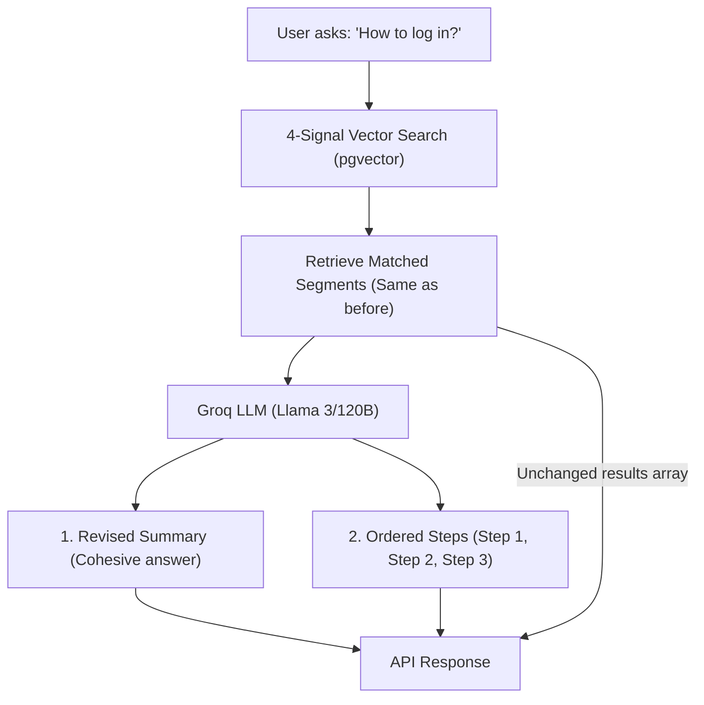

# Feature Specification: AI Overview & Step-by-Step Search

**Feature Branch**: `004-ai-overview-search`  
**Created**: 2026-10-22  
**Status**: Ready for Planning  
**Endpoint**: `POST /api/rag/knowledge/search/ai-overview/`  
**LLM Engine**: Groq (Llama-3/120B class, swappable for self-hosted LLM)

---

## 1. Executive Summary & Core Concept

### Overview
In the existing search endpoint (`POST /api/rag/knowledge/search/`), the backend returns a list of matching `results` (segments) with raw summaries and transcripts.

In this new endpoint **`POST /api/rag/knowledge/search/ai-overview/`**:
1. **The Segment Results Stay Exactly the Same**: The `results` array keeps the exact same fields, format, timestamps, and structure as before (`segment_id`, `knowledge_id`, `knowledge_title`, `start_time_seconds`, `end_time_seconds`, `page_start`, `page_end`, `matched_source`, etc.).
2. **LLM Revises the Summary & Creates Steps**: The LLM reads the matching segments and:
   * **Revises the Summary (`summary`)**: Produces a clean, cohesive summary answering the user's question.
   * **Breaks It Down into Steps (`steps`)**: Breaks the action into clear, sequential steps (`1.`, `2.`, `3.`), with each step attached to its corresponding `segment_id`.



---

## 2. API Contract & Schema

### Endpoint: `POST /api/rag/knowledge/search/ai-overview/`
* **Method:** `POST`
* **Content-Type:** `application/json`

#### Request Payload (Same parameters as existing search):
```json
{
  "question": "How do I log into my account?",
  "language": "en",
  "top_k": 3,
  "threshold": 0.25,
  "weights": {
    "question": 0.40,
    "keyword": 0.30,
    "summary": 0.20,
    "topic": 0.10
  }
}
```

#### Response Payload (`200 OK`):
```json
{
  "question": "How do I log into my account?",
  "language": "en",
  "summary": "To log into your account, open the official platform portal, locate the sign-in button in the upper right corner, and enter your verified username and password.",
  "steps": [
    {
      "step_number": 1,
      "title": "Open the platform",
      "instruction": "Navigate to the official portal website or launch the mobile app.",
      "segment_id": "c29385b3-2222-42ce-92dc-962bb1770b7d"
    },
    {
      "step_number": 2,
      "title": "Locate the sign-in button",
      "instruction": "Find and click the 'Sign In' or 'Log In' button in the navigation bar.",
      "segment_id": "c29385b3-2222-42ce-92dc-962bb1770b7d"
    },
    {
      "step_number": 3,
      "title": "Enter your credentials",
      "instruction": "Input your registered email address and password, then click Continue.",
      "segment_id": "d38496c4-3333-42ce-92dc-962bb1770b7d"
    }
  ],
  "count": 2,
  "weights_used": {
    "question": 0.4,
    "keyword": 0.3,
    "summary": 0.2,
    "topic": 0.1
  },
  "results": [
    {
      "segment_id": "c29385b3-2222-42ce-92dc-962bb1770b7d",
      "knowledge_id": "7c9e6679-7425-40de-944b-e07fc1f90ae7",
      "knowledge_title": "Account Access & Navigation Guide",
      "source_type": "video",
      "segment_index": 0,
      "title": "Accessing the Portal",
      "summary": "Overview of signing into the web portal.",
      "transcript": "Welcome to the portal. Click sign in on the top right...",
      "start_time_seconds": 0.0,
      "end_time_seconds": 30.0,
      "page_start": null,
      "page_end": null,
      "keywords": ["login", "portal", "account"],
      "score": 0.8842,
      "confidence": 0.8842,
      "best_match": "question",
      "confidence_by_type": {
        "question": 0.92,
        "keyword": 0.85,
        "summary": 0.87,
        "topic": 0.82
      },
      "matched_source": {
        "id": "b18274a2-1111-42ce-92dc-962bb1770b7d",
        "language": "en",
        "file_url": "https://pub-...r2.dev/videos/portal_intro.mp4",
        "duration_seconds": 60.0,
        "page_count": null,
        "is_fallback": false
      }
    },
    {
      "segment_id": "d38496c4-3333-42ce-92dc-962bb1770b7d",
      "knowledge_id": "7c9e6679-7425-40de-944b-e07fc1f90ae7",
      "knowledge_title": "Account Access & Navigation Guide",
      "source_type": "video",
      "segment_index": 1,
      "title": "Entering Credentials",
      "summary": "Entering username and password.",
      "transcript": "Type your registered email and password in the text fields...",
      "start_time_seconds": 30.0,
      "end_time_seconds": 60.0,
      "page_start": null,
      "page_end": null,
      "keywords": ["password", "credentials"],
      "score": 0.812,
      "confidence": 0.812,
      "best_match": "summary",
      "confidence_by_type": {
        "question": 0.75,
        "keyword": 0.80,
        "summary": 0.85,
        "topic": 0.70
      },
      "matched_source": {
        "id": "b18274a2-1111-42ce-92dc-962bb1770b7d",
        "language": "en",
        "file_url": "https://pub-...r2.dev/videos/portal_intro.mp4",
        "duration_seconds": 60.0,
        "page_count": null,
        "is_fallback": false
      }
    }
  ]
}
```

---

## 3. Prioritized User Stories

### User Story 1 - Revised Summary & Steps Linked to Segments (Priority: P1)
As a user searching for how to do something, I want to see a clear overall summary and sequential steps right at the top of my search results, with each step pointing to the relevant segment, while still keeping the familiar segment list below it.

* **Independent Test**: Call `POST /api/rag/knowledge/search/ai-overview/` with `"question": "How to log in?"`. Verify that `summary` and `steps` exist at the top level, and each item in `steps` has a valid `segment_id` that exists in `results`.

---

### User Story 2 - Swappable LLM Provider (Groq $\to$ Custom LLM) (Priority: P1)
As a developer, I want the LLM integration to use an abstract service (`BaseLLMService`) using Groq today (with configurable `GROQ_MODEL`), so that we can swap it for our own custom self-hosted LLM later with zero changes to views or serializers.

* **Independent Test**: Change `LLM_PROVIDER` in settings or instantiate a mock LLM; the API response structure remains identical.

---

### User Story 3 - Graceful Fallback if LLM Fails (Priority: P2)
If Groq experiences a timeout or error, the endpoint should still return the `results` segments normally (with `summary: null` and `steps: []`) rather than failing with a `500 Server Error`.

* **Independent Test**: Simulate an LLM timeout; response returns `200 OK` with all `results` intact.

---

## 4. Edge Cases

1. **No Segments Found**:
   - If vector search finds 0 segments above threshold, return `summary: null`, `steps: []`, `results: []` without calling the LLM.
2. **Informational vs. Step-by-Step Questions**:
   - If the user asks a non-procedural question (e.g. *"What is the company mission?"*), the LLM still returns a revised `summary` and either a single summary step or key takeaways in `steps`.
3. **Empty Question**:
   - Returns `400 Bad Request: {"question": "Question cannot be empty."}`.

---

## 5. Prompt Engineering & Model Hyperparameters

### 5.1. Model Hyperparameters

| Hyperparameter | Value | Rationale |
| :--- | :---: | :--- |
| **`temperature`** | **`0.1`** | **Critical for RAG accuracy.** Low temperature prevents creative hallucinations, enforces strict factual grounding, and ensures 100% compliant JSON formatting. |
| **`max_tokens`** | `1024` | Sufficient for a concise revised summary and 3–7 detailed action steps. |
| **`top_p`** | `0.9` | Focused nucleus sampling. |
| **`response_format`** | `{"type": "json_object"}` | Forces native JSON output from Groq / Llama 3 models. |

---

### 5.2. System Prompt Template

```text
You are an expert procedural AI assistant designed to synthesize search results into clear, step-by-step instructions.

You will be given a user's question and a list of verified knowledge segments retrieved from company videos and documents.

Your job:
1. Provide a concise, revised 'summary' directly answering the user's question in a professional, natural tone.
2. Break down the instructions into sequential 'steps' (1, 2, 3...).
3. For each step:
   - Provide an action-oriented 'title' (e.g. "Open the login portal").
   - Provide clear 'instruction' text explaining what to do.
   - Attach the exact 'segment_id' of the source segment that explains or demonstrates this step.

CRITICAL RULES:
- Grounding: Answer ONLY based on the provided segments. Do NOT invent steps or external information.
- Referential Integrity: 'segment_id' MUST exactly match one of the segment UUIDs provided in the context.
- Language: Output the response in the requested language (e.g. English or Khmer).
- Format: You must output ONLY a valid JSON object matching this schema:
  {
    "summary": "Cohesive natural language answer summary...",
    "steps": [
      {
        "step_number": 1,
        "title": "Short title",
        "instruction": "Detailed instruction...",
        "segment_id": "exact-uuid-from-context"
      }
    ]
  }
```

---

### 5.3. Context Injection Format (User Message)

```text
User Question: {question}
Target Language: {language}

Verified Knowledge Segments:
---
[Segment ID: {segment_id}]
Document: {knowledge_title}
Title: {segment_title}
Summary: {summary}
Transcript: {transcript}
---
[Segment ID: {segment_id_2}]
...
```
