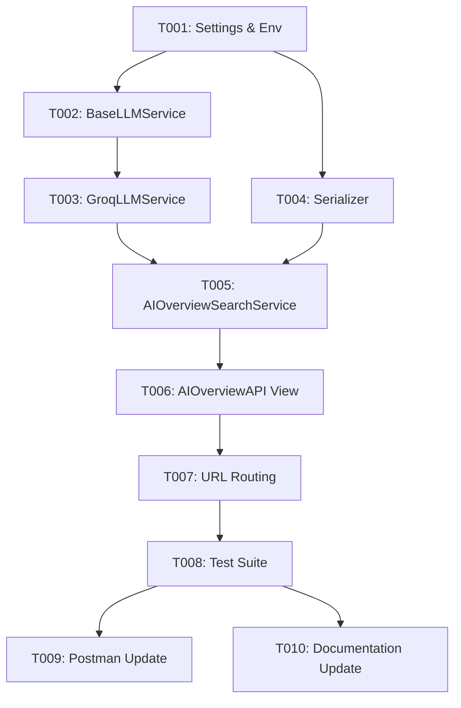

# Implementation Tasks: AI Overview & Step-by-Step Search

**Feature**: `004-ai-overview-search` | **Branch**: `004-ai-overview-search`  
**Spec**: [specs/004-ai-overview-search/spec.md](file:///d:/Khemra%20Backend/my-django-dockerv2/specs/004-ai-overview-search/spec.md) | **Plan**: [specs/004-ai-overview-search/plan.md](file:///d:/Khemra%20Backend/my-django-dockerv2/specs/004-ai-overview-search/plan.md)

---

## Phase 1: Setup & Environment Configuration

**Purpose**: Configure LLM environment variables and settings.

- [x] T001 Configure `GROQ_API_KEY`, `GROQ_MODEL`, and `LLM_PROVIDER` in `myproject/settings.py` with default fallbacks.

---

## Phase 2: Foundational Architecture & LLM Provider Abstraction

**Purpose**: Core interfaces, Groq adapter, and response serializers.

- [x] T002 [P] Create `apps/rag/services/BaseLLMService.py` defining the abstract base class `BaseLLMService` with `generate_ai_overview(question: str, language: str, segments: list) -> dict`.
- [x] T003 [P] Create `apps/rag/services/GroqLLMService.py` implementing `BaseLLMService` using OpenAI-compatible REST completions with `temperature=0.1`, `max_tokens=1024`, native JSON mode, strict prompt grounding, and timeout handling.
- [x] T004 [P] Create `apps/rag/serializers/AIOverviewResponseSerializer.py` defining `AIOverviewStepSerializer` and `AIOverviewResponseSerializer` with unchanged `results` schema.

---

## Phase 3: Core Orchestration & API Endpoint (User Story 1 - MVP)

**Goal**: Deliver `POST /api/rag/knowledge/search/ai-overview/` returning revised summary, steps with `segment_id`, and existing `results`.

- [x] T005 Create `apps/rag/services/AIOverviewSearchService.py` orchestrating `KnowledgeSearchService` vector search and `GroqLLMService` overview synthesis.
- [x] T006 Create `apps/rag/views/AIOverviewAPI.py` handling `POST` requests, input validation, and dispatching to `AIOverviewSearchService`.
- [x] T007 Register `search/ai-overview/` in `apps/rag/urls.py`, `apps/rag/views/__init__.py`, and `apps/rag/services/__init__.py`.

---

## Phase 4: Testing & Edge Cases (User Story 2 & 3)

**Goal**: Offline test suite validating successful synthesis, unchanged `results`, below-threshold fallback, and LLM error resilience.

- [x] T008 Create `apps/rag/tests/test_AIOverviewAPI.py` with mocked Groq calls testing:
  - Full AI overview response with steps and attached `segment_id`.
  - Unchanged `results` segment array.
  - Zero segments match fallback (bypasses LLM).
  - LLM timeout / 5xx error graceful degradation (returns search results with `summary: null`).

---

## Phase 5: Polish & Documentation

**Purpose**: Keep developer documentation and Postman collection up to date.

- [x] T009 [P] Add `POST /api/rag/knowledge/search/ai-overview/` request to `postman.json`.
- [x] T010 [P] Update `BACKEND_DOCUMENTATION.md` and `API_GUIDE.md` with the new endpoint schema and usage examples.

---

## Dependencies & Execution Order

